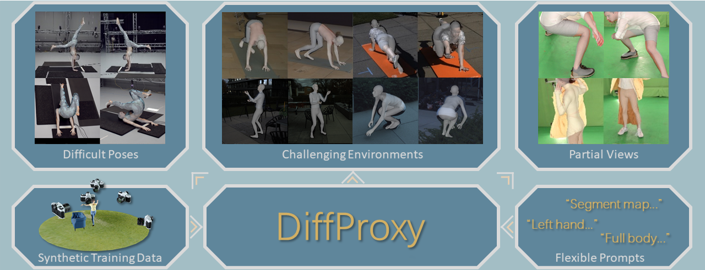

<div align="center">

# DiffProxy: Multi-View Human Mesh Recovery via Diffusion-Generated Dense Proxies

<div>
    <a href="https://wrk226.github.io/"><strong>Renke Wang</strong></a><sup>1</sup>,
    <a href="https://jessezhang92.github.io/"><strong>Zhenyu Zhang</strong></a><sup>2*</sup>,
    <a href="https://tyshiwo.github.io/"><strong>Ying Tai</strong></a><sup>2</sup>,
    <strong>Jun Li</strong><sup>1,2*</sup>,
    <a href="https://www.patternrecognition.asia/jian/"><strong>Jian Yang</strong></a><sup>1,2*</sup>
</div>

<div>
    <sup>1</sup><strong>PCA Lab, Nanjing University of Science and Technology</strong><br>
    <sup>2</sup><strong>School of Intelligent Science and Technology, Nanjing University</strong>
</div>

<div>
    <sup>*</sup><strong>Corresponding Authors</strong>
</div>

<br>

[](https://arxiv.org/abs/2601.02267)
[](https://wrk226.github.io/DiffProxy.html)

<br>

</div>

## 🚧 Release Checklist

- [x] Inference code
- [ ] Pretrained model weights (upload bundle prepared; public URL pending)
- [ ] Training code
- [ ] Synthetic training dataset

This release is inference-only. The training pipeline and the 105K-subject synthetic dataset described in the paper are not included at this stage.

## 🔍 Overview

DiffProxy recovers an SMPL-X mesh from calibrated multi-view RGB images in two stages:

1. **Dense proxy generation.** A Stable Diffusion 2.1 model equipped with MV-Adapter predicts part-segmentation and UV-correspondence maps. Test-time sampling additionally provides proxy uncertainty.
2. **SMPL-X fitting.** A differentiable renderer fits SMPL-X parameters to the dense proxies across views using body and hand priors. SMPLest-X parameters can optionally provide a warm start.

The included `demo.py` entry point can run both stages and export GT-free visualizations in the original image coordinates.

## 🗂️ Repository Structure

```text
.
├── assets/
├── configs/
│   └── view-guidance/
├── data/                         # external UV topology templates and SMPL-X models
├── dense_body/                   # dense UV and rendering utilities
├── mvadapter/                    # DiffProxy model and inference pipeline
├── tests/
├── pretrained/                   # downloaded DiffProxy weights
├── demo.py                       # one-command pipeline and visualization
├── infer_proxy.py                # Stage 1: segmentation/UV proxy generation
├── extract_smplx_init.py         # optional SMPLest-X mesh-to-parameter conversion
├── fit_smplx.py                  # Stage 2: SMPL-X fitting
├── DEMO.md
├── ENVIRONMENT.md
└── requirements.txt
```

## 🛠️ Installation

We recommend a fresh Python 3.10 environment:

```bash
conda create -n diffproxy python=3.10 -y
conda activate diffproxy
python -m pip install --upgrade --no-build-isolation -r requirements.txt
```

The validated release environment uses PyTorch 2.5.1, CUDA 12.1, and a matching PyTorch3D build. See [ENVIRONMENT.md](ENVIRONMENT.md) for the exact dependency baseline and optional packages.

By default, DiffProxy reads SMPL-X and DPoser-X assets in place and does not duplicate them into the home directory. To enable an optional reload cache, point it to a data disk explicitly:

```bash
export DIFFPROXY_CACHE_DIR=/path/to/data-disk/diffproxy-cache
```

### External assets

The following licensed third-party assets are not redistributed:

| Asset | Destination | Source |
|---|---|---|
| SMPL-X body models | `data/smplx/` | [SMPL-X](https://smpl-x.is.tue.mpg.de/) |
| DPoser-X source and body/hand checkpoints | `dependents/DPoser-X/` | [DPoser](https://github.com/moonbow721/DPoser) |
| VPoser source and checkpoint, only for `--body_prior vposer` | `dependents/human_body_prior/` | [human_body_prior](https://github.com/nghorbani/human_body_prior) |

The upload archive includes the DiffProxy UV topology templates at `data/diffproxy_uv_template.obj` and `data/diffproxy_hand_uv_template.obj`. They still require a separately licensed, topology-compatible SMPL-X body model.

Please follow the licenses of SMPL-X, DPoser-X, and all other third-party assets.

## 📦 Pretrained Models

<!-- WEIGHTS_URL: replace this comment with the public download URL after uploading the prepared bundle. -->

The public upload archive extracts directly into the repository root. It uses inference-only names and excludes optimizer, scheduler, callback, loop, and random-state data:

```text
data/
├── diffproxy_uv_template.obj
└── diffproxy_hand_uv_template.obj
pretrained/
├── diffproxy_ep30.ckpt
├── dinov2_large/                 # facebook/dinov2-large, pinned snapshot
└── proxy_vae/
    ├── config.json
    └── diffusion_pytorch_model.safetensors
```

The main checkpoint corresponds to the 30-epoch proxy-generator training reported in the paper. `proxy_vae/` is the single canonical VAE used for both UV and segmentation proxy decoding; it is reapplied after the main checkpoint is restored. Optimizer, scheduler, callback, loop, random-state, duplicate VAE tensors, and unsupported training-step metadata are not distributed.

Stable Diffusion 2.1 is an external prerequisite and is not redistributed in the DiffProxy bundle. Obtain and license a compatible SD2.1-base snapshot separately, then place it at `pretrained/sd21_base/` or set `SD_BASE_MODEL` to its local path. The release was validated with `Manojb/stable-diffusion-2-1-base@0094d483a120f3f33dafbd187ea4aa60d10de75c`; its model card declares `openrail++`. Users must review and accept the source model's license before downloading or using it.

The bundled DINOv2 snapshot is pinned to `facebook/dinov2-large@47b73eefe95e8d44ec3623f8890bd894b6ea2d6c` under Apache-2.0. `DINO_BASE_MODEL` may select another compatible local snapshot. The archive includes `licenses/` with the DINOv2 Apache-2.0 text, pinned model card, third-party notices, and the UV-template redistribution notice. The repository MIT license does not replace third-party model licenses.

## 📁 Input Data

DiffProxy expects calibrated views under `<base_data_dir>/<dataset>/`:

```text
<dataset>/
└── gt/
    ├── image_ori/
    │   └── {subject:04d}_{view:02d}.png
    ├── camera/
    │   └── {subject:04d}_{view:02d}.npz
    └── bbox/
        └── {subject:04d}_{view:02d}.json
```

Camera files contain `K`, `R`, and `T`, with `R,T` following the world-to-camera convention and `T` stored in millimetres. Bounding-box JSON files contain `{"tlwh": [...]}`.

For the two-stage pipeline, `--base_data_dir` must point to the directory named `evaluate`, and `--dataset_root` must point to its parent. Thus Stage 1 reads `<dataset_root>/evaluate/<dataset>/`, while Stage 2 receives `<dataset_root>`.

## 🚀 Inference

### One-command demo

Run Stage 1, Stage 2, and visualization for explicit subjects:

```bash
CUDA_DEVICE_ORDER=PCI_BUS_ID CUDA_VISIBLE_DEVICES=0 python demo.py \
  --base-data-dir /path/to/evaluate \
  --dataset data_example_4v \
  --subjects 0000,0003 \
  --run-pipeline \
  --output-dir demo_outputs/example
```

See [DEMO.md](DEMO.md) for the output contract, render-only mode, uncertainty maps, overlays, and traceable manifests.

### Stage 1: dense proxy generation

```bash
CUDA_DEVICE_ORDER=PCI_BUS_ID CUDA_VISIBLE_DEVICES=0 python infer_proxy.py \
  --base_data_dir /path/to/evaluate \
  --dataset data_example_4v \
  --exp sd21-ep30 \
  --tts_list 3 \
  --subjects 0000,0003
```

Stage 1 writes segmentation, UV, and uncertainty maps to:

```text
<dataset>/ours_4v/<exp>/tempt_tts03_v00_single/
```

### Optional SMPLest-X warm start

If SMPLest-X meshes are available:

```bash
python extract_smplx_init.py \
  --smplestx_dir /path/to/evaluate/<dataset>/smplestx
```

Pass the resulting parameter directory to Stage 2 with `--smplestx_init_dir`.

### Stage 2: SMPL-X fitting

```bash
CUDA_DEVICE_ORDER=PCI_BUS_ID CUDA_VISIBLE_DEVICES=0 python fit_smplx.py \
  --dataset_root /path/to/dataset_root \
  --dataset data_example_4v \
  --exp sd21-ep30 \
  --output_prefix pred \
  --tts_count 03_v00 \
  --dposer_hand_mult 0.5 \
  --seed 123 \
  --subjects 0000,0003
```

To enable the optional warm start:

```bash
--init_from_smplestx \
--smplestx_init_dir /path/to/evaluate/<dataset>/smplestx/init_smplxinit
```

Stage 2 outputs fitted parameters, SMPL-X meshes, projected joints, and per-view renders under `<dataset>/ours_4v/<exp>/`.

## 📋 Scope of This Release

Included:

- Stage-1 proxy-generation inference;
- Stage-2 SMPL-X fitting;
- optional SMPLest-X initialization;
- pretrained inference weights and DiffProxy UV topology templates;
- GT-free visualization and manifest generation.

Not included:

- proxy-generator or decoder training scripts;
- synthetic-data rendering and annotation generation;
- the synthetic training dataset;
- license-restricted SMPL-X and DPoser-X assets.

## 📚 Citation

If you find DiffProxy useful, please cite:

```bibtex
@article{wang2026diffproxy,
  title   = {DiffProxy: Multi-View Human Mesh Recovery via Diffusion-Generated Dense Proxies},
  author  = {Wang, Renke and Zhang, Zhenyu and Tai, Ying and Li, Jun and Yang, Jian},
  journal = {arXiv preprint arXiv:2601.02267},
  year    = {2026}
}
```

## 🙏 Acknowledgements

DiffProxy builds on [Stable Diffusion 2.1](https://huggingface.co/stabilityai/stable-diffusion-2-1-base), [MV-Adapter](https://github.com/huanngzh/MV-Adapter), [T2I-Adapter](https://github.com/TencentARC/T2I-Adapter), [DINOv2](https://github.com/facebookresearch/dinov2), [SMPL-X](https://github.com/vchoutas/smplx), [DPoser](https://github.com/moonbow721/DPoser), and [PyTorch3D](https://github.com/facebookresearch/pytorch3d).
